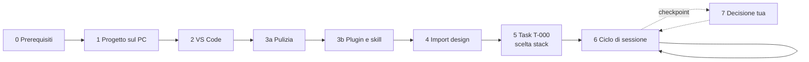

# RoutForge — Guida operativa per Diego

23 settembre 2026 · Diego

> Copia versionata della guida. La versione viva, modificabile e commentabile, è il documento condiviso
> "RoutForge — Guida operativa per Diego": https://claude.ai/code/artifact/a0f36568-af5d-4acc-bfe7-90cd8bd8ac7a
> Se le due versioni divergono, vale quella più recente; chiedi all'agente di riallinearle.

## Come usare questa guida

Segui le fasi in ordine: le fasi 0–5 si fanno una sola volta (circa 2 ore in tutto), la fase 6 a ogni sessione di lavoro, la fase 7 solo quando l'agente si ferma e ti chiede una decisione. Ogni passo ha un comando e una **verifica**: se la verifica non torna, non andare avanti e apri la sezione "Se qualcosa non va".



Le fasi da 0 a 5 preparano l'ambiente; da lì in poi si gira nel ciclo della fase 6, interrotto solo dai checkpoint.

| Fase | Quando | Tempo stimato | Risultato |
| --- | --- | --- | --- |
| 0 Prerequisiti | una volta | 30–45 min | strumenti installati e verificati |
| 1 Progetto sul PC | una volta | 10 min | 77 test verdi, repository su GitHub |
| 2 VS Code | una volta | 10 min | estensioni attive, hook visibili |
| 3a Pulizia | una volta, poi ogni tanto | 15–30 min | nessun accumulo di altri progetti dentro RoutForge |
| 3b Plugin e skill | una volta | 15–20 min | plugin e skill installati solo nel progetto |
| 4 Import design | una volta (e a ogni modifica del design) | 5–10 min | `design:check` con 0 file mancanti |
| 5 Task T-000 | una volta | 20–40 min (lo fa l'agente) | stack scelto e motivato |
| 6 Ciclo di sessione | ogni sessione | 1–3 task a sessione | task chiusi, test verdi, commit |
| 7 Checkpoint | 6 volte in tutto il progetto | variabile | decisione registrata |
| 8 Revisioni | a fine di ogni passo del piano | 10 min | seconda opinione di Codex |

**Chi fa cosa.** Tu installi, autorizzi, decidi ai checkpoint e leggi i riassunti. L'agente analizza le spec, scrive test e codice, esegue la verifica, aggiorna i documenti e fa i commit.

**Come leggere i comandi.**

- Blocco con `powershell`: va nel **terminale integrato di VS Code** (menu Terminale → Nuovo terminale).
- Blocco con `text` che inizia con `/`: va nel **prompt di Claude Code** (pannello dell'estensione o terminale dopo aver scritto `claude`).
- **Verifica**: il risultato che devi vedere prima di passare al passo successivo.

## Fase 0 — Prerequisiti sul PC

Servono otto strumenti, e molti probabilmente li hai già: per ognuno prima verifichi, poi installi solo ciò che manca. Git for Windows è obbligatorio anche per Claude Code, perché gli hook del progetto girano in Git Bash.

| Strumento | Verifica | Installa se manca | A cosa serve |
| --- | --- | --- | --- |
| Git for Windows | `git --version` | `winget install Git.Git` | versioni, Git Bash per gli hook |
| Node.js 22 LTS (minimo 20) | `node -v` | `winget install OpenJS.NodeJS.LTS` | test, build, npm |
| VS Code | `code --version` | `winget install Microsoft.VisualStudioCode` | ambiente di lavoro unico |
| PowerShell 7 | `pwsh --version` | `winget install Microsoft.PowerShell` | script del loop agentico |
| GitHub CLI | `gh --version` | `winget install GitHub.cli` | repository privato e pull request |
| Claude Code | `claude --version` | `irm https://claude.ai/install.ps1 \| iex` | esecutore del loop |
| Codex CLI | `codex --version` | `npm i -g @openai/codex` | revisore indipendente |
| OpenCode | `opencode --version` | `npm i -g opencode-ai` | task meccanici con modelli gratuiti |
| pipx (opzionale) | `pipx --version` | `winget install Python.Python.3.12`, poi `py -m pip install --user pipx` e `py -m pipx ensurepath` | solo per Graphify |

1. Apri **Terminale** di Windows (menu Start → "Terminale") in modalità PowerShell.
2. Esegui tutte le verifiche in una volta (un comando mancante dà errore, gli altri proseguono):

```powershell
git --version; node -v; code --version; pwsh --version; gh --version; claude --version; codex --version; opencode --version
```

3. Installa ciò che manca con la colonna "Installa se manca". Node va installato **prima** di Codex e OpenCode, perché si installano con `npm`.
4. Chiudi e riapri il terminale, così il PATH si aggiorna, poi ripeti le verifiche.
5. Se Claude Code c'era già, aggiornalo: serve una versione recente per il comando `/design`.

```powershell
claude update
```

6. Fai gli accessi, una volta sola:

```powershell
gh auth login        # GitHub.com → HTTPS → accesso dal browser
codex login          # account ChatGPT (piano gratuito)
claude               # al primo avvio: accedi con l'account del piano Max, poi esci con /exit
```

**Verifica.** Tutti gli otto comandi di verifica stampano un numero di versione; `node -v` mostra v20 o superiore; `gh auth status` dice che sei connesso.

## Fase 1 — Il progetto sul PC

Alla fine di questa fase il repository è in `C:\dev\routforge`, i 77 test passano e c'è una copia privata su GitHub. Usa lo **ZIP più recente** di questa conversazione: include i comandi `/stato` e `/gate`, lo script di pulizia `audit:claude` e i fine riga LF.

1. Scarica `routforge.zip` nella cartella Download.
2. Estrailo in una cartella **non sincronizzata** da OneDrive (Desktop e Documenti spesso lo sono): `node_modules` e `.git` contengono migliaia di file.

```powershell
New-Item -ItemType Directory -Force C:\dev | Out-Null
Expand-Archive -Path "$env:USERPROFILE\Downloads\routforge.zip" -DestinationPath C:\dev
cd C:\dev\routforge
```

3. Imposta la tua identità git, se non l'hai mai fatto. Il repository non ne ha una propria: i commit dell'agente useranno questa.

```powershell
git config --global user.name "Diego"
git config --global user.email "<la-tua-email>"
```

4. Installa le dipendenze ed esegui il gate:

```powershell
npm ci
npm run verify
```

5. Controlla che git sia pulito:

```powershell
git status
git log --oneline
```

6. Crea il repository privato su GitHub e carica tutto:

```powershell
gh repo create routforge --private --source . --push
```

**Verifica.**

- `npm run verify` termina con **Tests 77 passed (77)**.
- `git status` dice *nothing to commit, working tree clean*; `git log` mostra la cronologia, con il commit più recente in alto.
- `gh repo view --web` apre la pagina del repository; nella scheda **Actions** il primo controllo (CI) diventa verde in 1–2 minuti.

Se `git status` mostra molti file modificati senza che tu abbia toccato nulla, è un problema di fine riga: vedi la sezione "Se qualcosa non va".

## Fase 2 — VS Code

Alla fine di questa fase VS Code ha le cinque estensioni del progetto, il gate parte con una scorciatoia e Claude Code vede hook, comandi e subagent. Tutta la configurazione è già nella cartella `.vscode/`: tu devi solo accettarla.

1. Apri la cartella in VS Code:

```powershell
cd C:\dev\routforge
code .
```

2. Alla domanda "Ti fidi degli autori dei file in questa cartella?" rispondi **Sì**. Senza fiducia, attività ed estensioni restano disattivate.
3. Al popup "Installare le estensioni consigliate?" scegli **Installa**. Se il popup non compare: `Ctrl+Shift+X`, cerca `@recommended`, installa tutto ciò che è sotto *Workspace Recommendations* (Claude Code, Codex, Vitest, EditorConfig, GitLens).
4. Se VS Code chiede di usare la versione di TypeScript del workspace, scegli **Consenti**.
5. Premi `Ctrl+Shift+B`: parte l'attività **verify (gate)** nel terminale.
6. Apri il pannello **Testing** (icona della provetta nella barra laterale): devono comparire i test del progetto.
7. Apri Claude Code dal suo pannello (icona di Claude nella barra laterale o `Ctrl+Shift+P` → "Claude Code"). Se chiede l'accesso, usa l'account del piano Max.
8. Nel prompt di Claude Code controlla la configurazione:

```text
/hooks
```

Per i subagent non esiste più un comando dedicato: dalla versione 2.1.198 di Claude Code, `/agents` stampa solo un promemoria. Controllali con questa domanda. Le menzioni con `@` servono a scegliere un subagent dentro un messaggio: inviate da sole vengono lette come domande.

```text
Elenca i subagent di progetto disponibili in questa sessione, con nome e modello. Non modificare nulla.
```

Poi, nel terminale, controlla che i tre file si leggano senza errori:

```powershell
claude plugin validate .claude/agents
```

9. Scrivi `/` e guarda l'elenco dei comandi, poi fai una domanda di prova:

```text
Qual è il prossimo task secondo docs/STATO.md? Rispondi in una riga, senza modificare nulla.
```

**Verifica.**

- `Ctrl+Shift+B` termina con **Tests 77 passed (77)**.
- `/hooks` elenca un hook **SessionStart** e un hook **Stop**.
- La domanda sui subagent elenca **spec-reviewer** e **design-checker** (modello ereditato dalla sessione) e **test-writer** (Sonnet); `claude plugin validate .claude/agents` non segnala errori.
- Digitando `/` compaiono i comandi di progetto **/task**, **/gate**, **/scenario**, **/stato**, **/handoff**. (Il gate si chiama `/gate` perché `/verify` è già una skill integrata di Claude Code, con un altro scopo.)
- La risposta di prova indica **T-000** (import del design e scelta dello stack).

**Se il pannello Testing resta vuoto** (il gate con `Ctrl+Shift+B` è verde ma la provetta non mostra nulla), il progetto è a posto: il problema è l'estensione Vitest. Il gate vero resta `npm run verify`, quindi puoi proseguire con le fasi successive anche prima di sistemarlo. Controlla in quest'ordine:

1. **Modalità con restrizioni**: se VS Code la segnala (in alto o in basso a sinistra), clicca e scegli *Considera attendibile*. In quella modalità l'estensione Vitest non parte.
2. **Estensione attiva**: `Ctrl+Shift+X`, cerca `vitest.explorer`; deve risultare installata e non disabilitata. Da terminale:

```powershell
code --list-extensions | Select-String vitest
```

3. **Dipendenze installate**: deve esistere la cartella `node_modules\vitest`; se manca, esegui `npm ci`.
4. **Ricarica**: `Ctrl+Shift+P` → "Developer: Reload Window", poi nel pannello Testing premi il pulsante di aggiornamento dei test. I file compaiono dopo qualche secondo; i singoli test si vedono espandendo i file.
5. **Leggi il log**: `Ctrl+Shift+U` apre il pannello Output; nel menu a tendina a destra scegli **Vitest**.
    - "could not load any config" oppure `spawn EINVAL` → aggiorna l'estensione Vitest e riavvia VS Code;
    - errore su `node` non trovato → chiudi e riapri VS Code; se persiste, nelle Impostazioni utente (`Ctrl+,`) cerca "vitest node executable" e incolla il percorso stampato da `(Get-Command node).Source`;
    - la voce **Vitest** non esiste nel menu → l'estensione non si è attivata: torna ai punti 1 e 2.
6. Se è ancora vuoto, copia il log di Output → Vitest e incollalo in Claude Code chiedendo la causa radice.

Se preferisci Antigravity, i passi sono identici. Se un'estensione non si trova nel suo marketplace, per questo progetto usa VS Code.

## Fase 3a — Pulizia: solo ciò che serve a RoutForge

Tutto ciò che sta a livello utente (`~/.claude/`) si carica in **ogni** progetto: skill, comandi e plugin installati per altri progetti finiscono anche in RoutForge, occupano contesto e, a parità di nome, una skill personale vince su quella del progetto. La regola: ciò che serve a RoutForge vive nel repository; il livello utente tiene solo ciò che vale davvero ovunque.

| Livello | Dove sta | Dove si carica |
| --- | --- | --- |
| Utente | `~/.claude/` (skills, commands, agents, rules, CLAUDE.md, settings.json) | in tutti i progetti |
| Progetto | `.claude/` nel repository | solo in RoutForge; versionato su git |
| Locale | `.claude/settings.local.json` | solo in RoutForge e solo sul tuo PC; escluso da git |

**1. Fotografa il "prima".** Nel prompt di Claude Code, dentro RoutForge, scrivi `/context` e annota i valori delle righe Skills, Memory files e MCP tools.

**2. Fai l'inventario** (terminale; lo script legge soltanto, non modifica nulla):

```powershell
npm run audit:claude
```

Elenca skill, comandi, subagent e regole personali, il CLAUDE.md personale con i file che importa, plugin, hook, server MCP e soprattutto i **conflitti di nome** con RoutForge.

**3. Decidi voce per voce:**

| Se la voce… | Allora |
| --- | --- |
| serve davvero in tutti i progetti | resta a livello utente |
| serve solo a un altro progetto | spegnila solo in RoutForge (passo 4), oppure spostala nel `.claude/` di quel progetto |
| non la usi più | archiviala (passo 5) |
| compare tra i conflitti con RoutForge | archiviala o rinominala: oscura il comando del progetto |

**4. Spegni solo in RoutForge** (non distruttivo: negli altri progetti resta tutto com'è).

- **Skill**: `/skills` → evidenzia la skill → premi `Spazio` finché compare **off** → `Esc`. La scelta finisce in `.claude/settings.local.json`, solo sul tuo PC.
- **Plugin**: chiedi all'agente di scriverlo nelle impostazioni del progetto, così resta esplicito e versionato:

```text
In .claude/settings.json aggiungi a enabledPlugins le voci "<nome>@<marketplace>": false per questi plugin: <elenco dall'inventario>. Non toccare le altre impostazioni, poi fai commit.
```

**5. Archivia ciò che non usi più** (reversibile: sposta in `~/.claude-archivio/<data-ora>/`, non cancella). Usa `node` direttamente: in PowerShell `npm run` può perdere gli argomenti dopo `--`.

```powershell
node scripts/audit-claude.mjs --archivia tutto
```

Questa è una **prova a vuoto**: mostra cosa sposterebbe. Poi archivia solo ciò che hai scelto, con i nomi esatti dell'inventario:

```powershell
node scripts/audit-claude.mjs --archivia skill:<nome>,comando:<nome>,agente:<nome> --conferma
```

Se cambi idea, lo script stampa il comando di ripristino:

```powershell
node scripts/audit-claude.mjs --ripristina "<cartella indicata dallo script>"
```

Lo script non tocca mai plugin, impostazioni, CLAUDE.md, server MCP e skill sincronizzate: per quelli vale il passo 6.

**6. Le altre fonti di accumulo.**

- **CLAUDE.md personale** e i file che importa con `@` (ad esempio file di conoscenza come `knowledge_js.md`): `/memory` mostra cosa si carica. Ciò che serve solo ad altri progetti va nel CLAUDE.md di quei progetti.
- **Plugin che non usi più da nessuna parte**: `/plugin` → scheda Installed → Uninstall.
- **Skill sincronizzate da claude.ai** (arrivano perché accedi con l'account Max): spegni quelle superflue nelle impostazioni Skills di claude.ai, oppure aggiungi `"syncClaudeAiSkills": false` in `~/.claude/settings.json` per fermare la sincronizzazione su questo PC.
- **Server MCP di ambito utente**: `/mcp`, oppure `claude mcp remove <nome> -s user`.
- **Codex e OpenCode** hanno cartelle globali proprie: l'inventario le conta, e si puliscono con lo stesso criterio.

**7. Da qui in poi niente nuovi accumuli.** Ogni strumento di RoutForge si installa con ambito **progetto**: la Fase 3b indica il comando esatto per ciascuno.

**Verifica.**

- In una **nuova** sessione, `/context` mostra righe Skills e Memory files più leggere del "prima".
- `/skills` elenca solo gli strumenti di RoutForge e quelli universali che hai scelto di tenere.
- `npm run audit:claude` riporta **nessuno** sotto "Conflitti con RoutForge".
- Dopo qualche sessione di lavoro, `/skill-doctor` mostra cosa non hai mai usato: è il candidato per la prossima pulizia.

## Fase 3b — Plugin e skill di Claude Code (ambito progetto)

Il minimo per partire sono **Superpowers** e **Ponytail**; gli altri si aggiungono anche dopo. Ogni comando `/plugin` va inviato come **messaggio separato** nel prompt di Claude Code. Alla domanda sull'ambito scegli sempre **Project**: il plugin viene registrato in `.claude/settings.json` del repository e si attiva solo in RoutForge.

| Strumento | Priorità | Cosa ti dà nel progetto |
| --- | --- | --- |
| Superpowers | subito | brainstorm → piano → esecuzione con TDD per i task grandi |
| Ponytail | subito | meno codice e meno astrazioni, `/ponytail-review` prima dei commit grandi |
| claude-council | subito se hai fatto `codex login` | seconda opinione di Codex ai checkpoint |
| Skill di Pocock (grill-me, git-guardrails) | consigliata | piani interrogati a fondo, blocco dei comandi git distruttivi |
| Impeccable | prima dello sviluppo della UI | qualità e fedeltà visiva delle schermate |
| Graphify | opzionale | grafo del progetto interrogabile, meno token per rileggere le spec |

1. **Superpowers** (prompt di Claude Code; all'installazione scegli ambito **Project**):

```text
/plugin install superpowers@claude-plugins-official
```

2. **Ponytail** (due messaggi separati; all'installazione scegli ambito **Project**):

```text
/plugin marketplace add DietrichGebert/ponytail
```

```text
/plugin install ponytail@ponytail
```

3. **claude-council** (tre messaggi separati; all'installazione scegli ambito **Project**; l'ultimo controlla che Codex risponda):

```text
/plugin marketplace add hex/claude-marketplace
```

```text
/plugin install claude-council
```

```text
/claude-council:status
```

4. **Skill di Pocock** (terminale di VS Code). Non installare la skill `handoff`: il progetto ha già il suo comando `/handoff`. Senza `-g` le skill restano nel progetto, e `-a claude-code` evita copie per altri agenti; se chiede come installare, su Windows scegli la **copia** invece del collegamento simbolico.

```powershell
npx skills add mattpocock/skills --skill grill-me --skill git-guardrails-claude-code -a claude-code
```

5. **Impeccable**: installalo ora, solo per Claude Code e solo in questo progetto; il comando `/impeccable init` lo esegui dopo l'import del design (Fase 4).

```powershell
npx impeccable install --providers=claude --scope=project
```

6. **Graphify** (opzionale, richiede pipx dalla Fase 0):

```powershell
pipx install graphifyy
graphify install --project
```

7. Ricarica Claude Code perché carichi i plugin: scrivi `/exit` e riapri il pannello (oppure `Ctrl+Shift+P` → "Developer: Reload Window").
8. Alcune installazioni aggiungono file al repository. Chiedi all'agente di salvarli:

```text
Controlla git status e fai un commit dei file aggiunti dall'installazione di plugin e skill, con messaggio "chore: plugin e skill". Non modificare altro.
```

**Verifica.**

- `/plugin` elenca **superpowers**, **ponytail** e **claude-council** come attivi, con ambito **Project**.
- `.claude/settings.json` contiene `enabledPlugins` con i tre plugin, e il commit "chore: plugin e skill" li ha salvati.
- `/claude-council:status` mostra Codex come disponibile.
- `npm run audit:claude` non mostra nuove voci a livello utente rispetto alla Fase 3a.
- `npm run verify` è ancora verde e `git status` è pulito.

Se un comando di installazione non viene riconosciuto, il nome del plugin potrebbe essere cambiato: la sezione 1 di `docs/04_STRUMENTI.md` riporta repository e comandi da ricontrollare.

## Fase 4 — Import del design da Claude Design

Alla fine di questa fase tutti i 45 file del progetto di design sono nella cartella `design/` e `npm run design:check` segnala 0 mancanti. Questo sblocca il task T-000, dove l'agente sceglie lo stack.

**Via principale: comando `/design`.**

1. Nel prompt di Claude Code:

```text
/design
```

2. Scegli il progetto **RoutForge**. Se chiede una cartella di destinazione, indica `design/`.
3. Se i file finiscono in un'altra cartella, chiedi all'agente di spostarli:

```text
Sposta tutti i file appena importati da Claude Design dentro design/, mantenendo le sottocartelle (design/, spec/). Non modificare il contenuto dei file e non fare commit.
```

**Via manuale, se `/design` non è disponibile.**

1. Apri il progetto su claude.ai/design → **Export** → **Download as .zip**.
2. Estrai lo ZIP dentro `design/`:

```powershell
Expand-Archive -Path "$env:USERPROFILE\Downloads\<nome-export>.zip" -DestinationPath C:\dev\routforge\design
```

**Poi, in entrambi i casi:**

1. Controlla che non manchi nulla:

```powershell
npm run design:check
```

2. Se il controllo elenca dei file mancanti, confronta i nomi: spesso cambia solo una sottocartella. Lo script cerca i file in tutto `design/`, a qualsiasi profondità.
3. Esegui l'inizializzazione di Impeccable (Fase 3b, passo 5). Quando chiede il contesto di design, indica `design/DESIGN.md` e `design/tokens.css`.

```text
/impeccable init
```

4. Opzionale, se hai installato Graphify: crea il primo grafo del progetto.

```text
/graphify .
```

**Verifica.**

- `npm run design:check` stampa **0 file mancanti**.
- Esistono `design/tokens.css`, `design/DESIGN.md`, `design/HANDOFF.md` e i due moduli del corso di esempio `M0-Riattivazione_JavaScript.md` e `M1-Tooling_Moderno.md`.
- `git status` mostra i file di design come nuovi: è normale, il commit lo fa l'agente in T-000.

Il design non si modifica mai dal repository. Se cambi qualcosa in Claude Design, rifai l'import con `/design` e chiedi all'agente di riallineare le schermate già costruite.

## Fase 5 — Primo task: T-000 e scelta dello stack

In questo task l'agente legge tutto il design, verifica l'handoff e **sceglie lo stack motivandolo**; tu leggi la decisione e puoi porre il veto prima che venga costruita la UI (task T-006). Dura 20–40 minuti e lo fai con il modello più capace.

1. Scegli il modello indicato nella colonna **Modello** del backlog:

```text
/model
```

Seleziona **Claude Fable 5.1** dall'elenco.

2. Avvia il task:

```text
/task T-000
```

3. Rispondi alle richieste di permesso con questo criterio:

| Richiesta | Risposta |
| --- | --- |
| Lettura di file, `npm`, `node`, `git status/diff/log/add/commit`, creazione di cartelle dentro il repo | Consenti (anche "non chiedere più" per i comandi di sola lettura) |
| Installazione di una dipendenza del progetto (`npm install <nome>`) | Consenti solo se l'agente ne spiega il motivo |
| Cancellazioni fuori dal repo, `git push --force`, `git reset --hard`, lettura di `.env`, installazioni globali | Rifiuta e chiedi perché servono |

4. Mentre lavora non devi fare nulla. L'agente, nell'ordine: controlla i file di design, annota le **divergenze design ↔ spec** in `docs/STATO.md`, esegue il parser sui moduli M0 e M1 e lo confronta con `design/course-data.js`, sceglie lo stack, aggiorna l'architettura e fa il commit.
5. Quando finisce, leggi il suo riassunto di cinque righe. Poi apri questi due punti:
    - `docs/STATO.md` → sezioni "Fatto", "Divergenze design ↔ spec" e "Checkpoint in attesa";
    - `docs/01_DECISIONI.md` → riga **D-STACK-1** (scelta, motivi, alternative scartate).
6. Se sei d'accordo, non devi scrivere nulla. Se non lo sei, poni il veto **prima di T-006**:

```text
Non sono d'accordo con D-STACK-1 perché <motivo>. Valuta <alternativa> con i criteri di docs/02_ARCHITETTURA.md §0 e riscrivi la decisione.
```

7. Torna al modello standard per i task normali:

```text
/model
```

Seleziona **Claude Sonnet 5**.

**Verifica.**

- In `docs/TASKS.md` la riga T-000 è **fatto**.
- D-STACK-1 contiene scelta, motivi e alternative scartate, non più "aperta".
- La sezione "Divergenze design ↔ spec" è compilata, oppure dice esplicitamente che non ce ne sono.
- `npm run design:check` e `npm run verify` sono verdi; `git log` mostra il commit di T-000.

## Fase 6 — Il ciclo di ogni sessione

Ogni sessione chiude da 1 a 3 task con lo stesso schema: apri, `/task next`, leggi il riassunto, ripeti, poi `git push`. L'agente riprende sempre dal punto giusto perché a ogni avvio legge `docs/STATO.md`.

**Inizio sessione**

1. Apri VS Code nella cartella del progetto e controlla che `git status` sia pulito.
2. Apri una **nuova** sessione di Claude Code: l'hook carica lo stato e i prossimi task.
3. Guarda la riga del prossimo task in `docs/TASKS.md` e preparati di conseguenza:

| Nella riga del task | Cosa fai prima di `/task next` |
| --- | --- |
| colonna **Modello** | `/model` → il modello indicato: **Fable 5.1**, **Opus 5.5**, **Sonnet 5** o **Haiku 4.5** |
| **R** (rischioso: dati, plugin nativi, sync) | attività **snapshot**: Terminale → Esegui attività… → snapshot |
| **M** (meccanico) | puoi delegarlo a OpenCode (Fase 8) |
| **CPn** (checkpoint prima di iniziare) | vai alla Fase 7 |

Fable 5.1 è previsto solo per quattro task (T-000, T-013, T-019, T-033): consuma molta quota. Se il gate resta rosso dopo due tentativi, passa al modello superiore: Haiku → Sonnet → Opus → Fable. Se ti dimentichi di cambiare modello, `/task` te lo ricorda prima di iniziare.

**Durante**

4. Avvia il task:

```text
/task next
```

5. Leggi il riassunto di cinque righe e controlla tre cose: il numero di test è salito, gli scenari del task sono citati come coperti, i "problemi aperti" non contengono sorprese.
6. Ripeti il passo 4 per il task successivo, fino a 3 task per sessione. Se la conversazione diventa lunga, scrivi `/compact`.

**Fine sessione**

7. Se ti fermi per più giorni o la sessione è stata lunga, crea un passaggio di consegne:

```text
/handoff
```

8. Carica il lavoro su GitHub (l'agente fa i commit, ma non il push):

```powershell
git push
```

9. Ogni 10 task circa, se usi Graphify, aggiorna il grafo con `/graphify .`.

**Modalità semi-autonoma (dopo i primi 5–10 task).** Quando ti fidi del processo, fai girare più task di fila. Il loop si ferma da solo a un checkpoint, a un blocco o con il gate rosso, e crea prima un tag git per tornare indietro.

```powershell
pwsh -File scripts/loop.ps1 -MaxTasks 3 -Model sonnet
```

Il loop usa un solo modello: lancialo solo su task consecutivi che nella colonna **Modello** hanno lo stesso valore.

In alternativa: Terminale → Esegui attività… → **loop agentico (3 task)**. Alla fine leggi `docs/STATO.md` e `git log --oneline -10`.

**Verifica di fine sessione.** `Ctrl+Shift+B` verde, `git status` pulito, `docs/STATO.md` aggiornato con data e prossimo task, `git push` riuscito.

## Fase 7 — I checkpoint

In tutto il progetto l'agente si ferma per te sei volte, più gli eventuali blocchi: te ne accorgi perché in cima a `docs/STATO.md` compare una riga `CHECKPOINT:` o `BLOCCO:`. Rispondi in Claude Code; l'agente registra la decisione in `docs/01_DECISIONI.md`, cancella la riga e riprende.

**Procedura, uguale per tutti.**

1. Leggi la riga `CHECKPOINT:` o `BLOCCO:` e il task a cui si riferisce.
2. Prepara ciò che serve (tabella sotto).
3. Rispondi con un messaggio che inizia con l'identificativo, ad esempio:

```text
CP3: ho Android Studio installato e un telefono Android con debug USB attivo. iOS rinviato. Registra la decisione, togli il checkpoint e prosegui.
```

| Checkpoint | Quando | Cosa prepari | Cosa rispondi |
| --- | --- | --- | --- |
| **CP1 Stack** (informativo) | fine di T-000 | leggi D-STACK-1 in `docs/01_DECISIONI.md` | nulla se sei d'accordo; il veto (Fase 5, passo 6) entro T-006 |
| **CP2 Prima schermata** | dopo T-008 (schermata Oggi) | avvia l'app con il comando indicato in `docs/STATO.md` (di solito `npm run dev`); aprila nel browser; `F12` poi `Ctrl+Shift+M` per la vista mobile; confrontala con `S1 Oggi Mobile` e `S1 Oggi Desktop` in `design/` | "CP2: approvata" oppure l'elenco delle differenze; puoi chiedere prima un controllo al subagent **design-checker** |
| **CP3 Nativo** | prima di T-021 (notifiche e sveglie) e T-023 (widget) | Android Studio (`winget install Google.AndroidStudio`) con un SDK installato; un telefono Android con Opzioni sviluppatore → Debug USB, oppure un emulatore | cosa hai a disposizione; iOS resta rinviato finché non hai un Mac |
| **CP4 Sync** | prima di T-033 | scelta del servizio di sincronizzazione (candidato: Supabase, account gratuito); URL e chiave del progetto **solo** in un file `.env.local`, mai nei messaggi | il servizio scelto e se cifrare la chiave Gemini prima della sincronizzazione (consigliato: sì) |
| **CP5 AI** | prima di T-026 | una chiave Gemini da Google AI Studio, da inserire solo nelle Impostazioni dell'app quando esistono; i test automatici usano risposte simulate | conferma o correggi D-QUIZ-1 (come si considera superato il criterio "Domande socratiche") |
| **CP6 Release** | dopo T-035 | nome e icona definitivi; una keystore per firmare l'APK, con copia di backup **fuori** dal repository; dove pubblicare la versione web | le tre scelte; l'agente prepara build e pubblicazione |

**Un `BLOCCO:`** significa che manca un'informazione che le spec non danno. Rispondi solo alla domanda scritta lì, nello stesso formato: `BLOCCO: <risposta>`.

**Mai nei messaggi all'agente o nei file del repository:** chiavi API, password, keystore. I file `.env` e `.env.*` sono già esclusi da git e l'agente non ha il permesso di leggerli.

## Fase 8 — Revisioni con Codex e task delegati a OpenCode

Una revisione indipendente va fatta alla fine di ogni **passo** del piano (i dieci passi di CONTESTO §6, ad esempio "scheduler completato"), non a ogni task: il piano gratuito di Codex ha poca quota. OpenCode serve solo per i task marcati **M**.

**Revisione di fine passo (tre livelli, dal più economico).**

1. **Subagent spec-reviewer** (incluso nel piano Max), nel prompt di Claude Code:

```text
@agent-spec-reviewer rivedi tutto il passo appena completato (<nome del passo>) e riportami il rapporto, senza modificare file.
```

2. **Codex**, dal suo pannello in VS Code oppure con `codex` nel terminale. Chiedi una revisione in sola lettura:

```text
Sola lettura, non modificare file. Rivedi i commit del passo <nome> rispetto a docs/spec/RoutForge_MECCANISMI.md §<numeri>: elenca regole mancanti, soglie diverse dalla spec e casi limite non testati, con file e riga.
```

3. **claude-council**, solo per decisioni architetturali o quando l'agente fallisce tre volte lo stesso task: chiedi dal prompt di Claude Code di confrontare la sua proposta con quella di Codex tramite il plugin.
4. Riporta i risultati a Claude Code, che corregge:

```text
Ecco il rapporto di revisione: <incolla>. Correggi i punti GRAVE e MEDIO, ognuno con un test, poi /gate e commit.
```

**Task meccanici con OpenCode (marcati M, ad esempio T-025 e T-031).**

1. Lavora sempre su un branch separato:

```powershell
git switch -c agent/opencode/T-031
opencode
```

2. In OpenCode scegli il modello **Nemotron 3.5 Lightning Free** e scrivi:

```text
Leggi AGENTS.md e la riga T-031 di docs/TASKS.md. Esegui solo quel task. Esegui npm run verify finché è verde, poi fai commit sul branch corrente.
```

3. Torna al branch principale e fai rivedere il lavoro a Claude Code:

```powershell
git switch main
```

```text
Rivedi il branch agent/opencode/T-031 con il subagent spec-reviewer. Se è conforme, fai il merge in main e aggiorna docs/TASKS.md e docs/STATO.md.
```

**Regole sui dati.** I modelli gratuiti di OpenCode sono endpoint di prova, e le varianti Muse "Contributor" usano i dati per l'addestramento. Non inviare mai chiavi, password o dati personali; se non vuoi che codice e spec di RoutForge vengano riutilizzati, non usare OpenCode e lascia i task M a Claude Haiku 4.5.

**Verifica.** Dopo ogni revisione il rapporto è stato applicato (commit di correzione con test), `npm run verify` è verde e il branch dell'agente delegato è stato unito o cancellato.

## Se qualcosa non va

Quasi tutti i problemi del primo avvio sono di PATH, permessi di PowerShell o cartella sbagliata. Cerca il sintomo nella prima colonna; se non c'è, incolla l'errore completo nel prompt di Claude Code e chiedi la causa radice.

| Sintomo | Causa probabile | Soluzione |
| --- | --- | --- |
| `claude`, `codex` o `opencode` "non riconosciuto" dopo l'installazione | PATH non aggiornato | chiudi e riapri terminale e VS Code; se persiste, esci e rientra in Windows |
| `/design` è un comando sconosciuto | Claude Code non aggiornato | `claude update`; in alternativa usa la via manuale della Fase 4 |
| `npm ci` fallisce | Node troppo vecchio o rete | `node -v` deve dare v20 o più; aggiorna Node e riprova |
| Il commit fallisce con "Please tell me who you are" | identità git non impostata | Fase 1, passo 3 |
| `gh repo create` dice che il repository esiste già | nome già usato sul tuo account | scegli un altro nome, ad esempio `gh repo create routforge-app --private --source . --push` |
| `git status` mostra molti file modificati senza che tu li abbia toccati | fine riga CRLF/LF | `git add --renormalize .` poi `git status`; se cambiano solo i fine riga, fai commit con messaggio "chore: normalizza fine riga" |
| `/hooks` non elenca SessionStart e Stop | cartella aperta sbagliata o Git for Windows assente | apri `C:\dev\routforge` come cartella radice; installa Git for Windows; `claude update`; nuova sessione |
| `scripts/loop.ps1`: "l'esecuzione di script è disabilitata" | criterio di esecuzione di PowerShell | `Set-ExecutionPolicy -Scope CurrentUser RemoteSigned`, poi `Unblock-File scripts\loop.ps1` |
| `pwsh` non riconosciuto | manca PowerShell 7 | `winget install Microsoft.PowerShell`, oppure `powershell -File scripts\loop.ps1` |
| L'agente non chiude il turno e ripete che il gate è rosso | un test che non riesce a far passare | premi `Esc`; esegui tu `npm run verify` e leggi l'errore; chiedi "trova la causa radice, non il sintomo" oppure una revisione di Codex (Fase 8) |
| I test "passano" ma il task sembra incompleto | file `.claude/hooks/SKIP_VERIFY` dimenticato: il gate è disattivato | `Remove-Item .claude\hooks\SKIP_VERIFY`, poi `npm run verify` |
| `design:check` elenca ancora file mancanti | export incompleto o nomi diversi | chiedi all'agente di confrontare l'elenco atteso con i file presenti e di dirti cosa manca davvero; se serve, riesporta |
| Messaggio di limite del piano Max | quota della finestra esaurita | aspetta il reset; usa Sonnet 5 invece di Fable; `/compact`; nel loop usa `-MaxTasks 1` |
| Codex risponde "quota esaurita" | piano gratuito OpenAI | usa il subagent spec-reviewer e rimanda la revisione di Codex |
| Un'estensione non si trova in Antigravity | marketplace diverso (Open VSX) | per questo progetto usa VS Code |

Se hai un dubbio su un comando git che l'agente vuole eseguire, rifiuta e chiedi spiegazioni: i comandi distruttivi sono bloccati nelle impostazioni, ma nessun blocco sostituisce il tuo controllo.

## Checklist riassuntiva

Spunta le voci mentre procedi: le prime cinque fasi si chiudono una volta, le ultime tre restano come promemoria per ogni sessione.

**Fase 0 — Prerequisiti**

- [ ] Verificati gli otto strumenti e installati quelli mancanti
- [ ] `claude update` eseguito
- [ ] Accessi fatti: `gh auth login`, `codex login`, Claude Code con l'account Max

**Fase 1 — Progetto sul PC**

- [ ] ZIP più recente estratto in `C:\dev\routforge`
- [ ] Identità git globale impostata
- [ ] `npm ci` e `npm run verify` → 77 test passati
- [ ] Repository privato su GitHub con la CI verde

**Fase 2 — VS Code**

- [ ] Cartella aperta, fiducia concessa, cinque estensioni installate
- [ ] `Ctrl+Shift+B` verde e test visibili nel pannello Testing
- [ ] `/hooks` e comandi di progetto visibili; la domanda sui subagent elenca i tre subagent; la domanda di prova risponde T-000

**Fase 3a — Pulizia**

- [ ] `/context` annotato come "prima"
- [ ] Inventario con `npm run audit:claude` e decisione voce per voce
- [ ] Skill e plugin di altri progetti spenti in RoutForge; il superfluo archiviato
- [ ] Nessun conflitto di nome e `/context` più leggero in una nuova sessione

**Fase 3b — Plugin e skill (ambito progetto)**

- [ ] Superpowers e Ponytail installati con ambito Project
- [ ] claude-council installato con ambito Project; `/claude-council:status` vede Codex
- [ ] Skill grill-me e git-guardrails senza `-g`, Impeccable con `--scope=project`, Graphify se lo vuoi
- [ ] Commit "chore: plugin e skill" fatto dall'agente

**Fase 4 — Design**

- [ ] Design importato in `design/`; `npm run design:check` → 0 mancanti
- [ ] `/impeccable init` eseguito; `/graphify .` se usi Graphify

**Fase 5 — T-000**

- [ ] `/model` → Fable 5.1, poi `/task T-000` completato
- [ ] Letti D-STACK-1 e le divergenze design ↔ spec; veto dato se necessario
- [ ] `/model` → Sonnet 5 per i task successivi

**Fase 6 — Ogni sessione**

- [ ] Nuova sessione di Claude Code e marcatore del prossimo task controllato
- [ ] `/task next` per 1–3 task, riassunto letto ogni volta
- [ ] `/handoff` se ti fermi a lungo, poi `git push`

**Fasi 7 e 8 — Quando capita**

- [ ] Ogni checkpoint risposto con "CPn: …" e ripresa del loop verificata
- [ ] Revisione di fine passo applicata con test e commit
