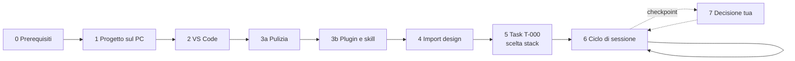

# RoutForge — Guida operativa per Diego

23 settembre 2026, aggiornata il 24 settembre 2026 · Diego

> Copia versionata della guida. La versione viva, modificabile e commentabile, è il documento condiviso
> "RoutForge — Guida operativa per Diego": https://claude.ai/code/artifact/a0f36568-af5d-4acc-bfe7-90cd8bd8ac7a
> Se le due versioni divergono, vale quella più recente; chiedi all'agente di riallinearle.

## Come usare questa guida

Segui le fasi in ordine: le fasi 0–5 si fanno una sola volta (circa 2 ore in tutto), la fase 6 a ogni sessione di lavoro, la fase 7 solo quando l'agente si ferma e ti chiede una decisione. Ogni passo ha un comando e una **verifica**: se la verifica non torna, non andare avanti e apri la sezione "Se qualcosa non va".



Le fasi da 0 a 5 preparano l'ambiente; da lì in poi si gira nel ciclo della fase 6, interrotto solo dai checkpoint.

| Fase | Quando | Tempo stimato | Risultato |
| --- | --- | --- | --- |
| 0 Prerequisiti | una volta | 30–45 min | strumenti installati e verificati |
| 1 Progetto sul PC | una volta | 10 min | tutti i test verdi, repository su GitHub |
| 2 VS Code | una volta | 10 min | estensioni attive, hook visibili |
| 3a Pulizia | una volta, poi ogni tanto | 15–30 min | nessun accumulo di altri progetti dentro RoutForge |
| 3b Plugin | una volta | 5 min | plugin dichiarati dal repository e installati alla prima apertura |
| 4 Import design | una volta (e a ogni modifica del design) | 5–10 min | `design:check` con 0 file mancanti |
| 5 Task T-000 | una volta | 20–40 min (lo fa l'agente) | stack scelto e motivato |
| 6 Ciclo di sessione | ogni sessione | 1–3 task a sessione | task chiusi, test verdi, commit |
| 7 Checkpoint | 6 volte in tutto il progetto | variabile | decisione registrata |
| 8 Revisioni | a fine di ogni passo del piano | 10 min | seconda opinione di Codex |

**Chi fa cosa.** Tu installi, autorizzi, decidi ai checkpoint e leggi i riassunti. L'agente analizza le spec, scrive test e codice, esegue la verifica, aggiorna i documenti e fa i commit.

**Come leggere i comandi.**

- Blocco con `powershell`: va nel **terminale integrato di VS Code** (menu Terminale → Nuovo terminale).
- Blocco con `text` che inizia con `/`: va nel **prompt di Claude Code** (pannello dell'estensione o terminale dopo aver scritto `claude`).
- **Verifica**: il risultato che devi vedere prima di passare al passo successivo.

## Stato al 24 settembre 2026 e da dove riprendere

Il repository è in `C:\Users\hidal\Downloads\routforge\routforge` con la cronologia git. Fatto: fondamenta verificate in due passate (`docs/AUDIT_FOUNDATION.md`), gate `npm run verify` con typecheck, lint, formato e 102 test, CP0 deciso (ora locale di parete, D-TIME-2), plugin dichiarati dal repository, cartella dell'export del design rinominata `claude-design/`, commit `e67b04e` e successivi.

Da fare, in ordine:

1. **Remote e CI**: Fase 1, passo 6 (`gh repo create …`), poi `git push`. La CI non è mai partita.
2. **Plugin**: alla prossima apertura di Claude Code conferma l'installazione dei plugin dichiarati (Fase 3b).
3. **Design**: Fase 4. Il progetto Claude Design contiene 43 file su 45: i due moduli del corso di esempio (`M0-Riattivazione_JavaScript.md`, `M1-Tooling_Moderno.md`) vanno copiati a mano in `claude-design/spec/`.
4. **T-000** con Fable 5.1 (Fase 5). Nel frattempo, senza il design, l'agente può fare `/task T-011` e poi `/task T-012` con Opus 5.5.

Checkpoint che restano: CP1 (informativo) e CP2–CP6 (Fase 7).

## Fase 0 — Prerequisiti sul PC

Servono otto strumenti, e molti probabilmente li hai già: per ognuno prima verifichi, poi installi solo ciò che manca. Git for Windows è obbligatorio anche per Claude Code, perché gli hook del progetto girano in Git Bash.

| Strumento | Verifica | Installa se manca | A cosa serve |
| --- | --- | --- | --- |
| Git for Windows | `git --version` | `winget install Git.Git` | versioni, Git Bash per gli hook |
| Node.js 22 LTS (minimo 20) | `node -v` | `winget install OpenJS.NodeJS.LTS` | test, build, npm |
| VS Code | `code --version` | `winget install Microsoft.VisualStudioCode` | ambiente di lavoro unico |
| PowerShell 7 | `pwsh --version` | `winget install Microsoft.PowerShell` | script del loop agentico |
| GitHub CLI | `gh --version` | `winget install GitHub.cli` | repository privato e pull request |
| Claude Code | `claude --version` | `irm https://claude.ai/install.ps1 \| iex` | esecutore del loop |
| Codex CLI | `codex --version` | `npm i -g @openai/codex` | revisore indipendente |
| OpenCode | `opencode --version` | `npm i -g opencode-ai` | task meccanici con modelli gratuiti |
| pipx (opzionale) | `pipx --version` | `winget install Python.Python.3.12`, poi `py -m pip install --user pipx` e `py -m pipx ensurepath` | solo per Graphify |

1. Apri **Terminale** di Windows (menu Start → "Terminale") in modalità PowerShell.
2. Esegui tutte le verifiche in una volta (un comando mancante dà errore, gli altri proseguono):

```powershell
git --version; node -v; code --version; pwsh --version; gh --version; claude --version; codex --version; opencode --version
```

3. Installa ciò che manca con la colonna "Installa se manca". Node va installato **prima** di Codex e OpenCode, perché si installano con `npm`.
4. Chiudi e riapri il terminale, così il PATH si aggiorna, poi ripeti le verifiche.
5. Se Claude Code c'era già, aggiornalo: serve una versione recente per il comando `/design`.

```powershell
claude update
```

6. Fai gli accessi, una volta sola:

```powershell
gh auth login        # GitHub.com → HTTPS → accesso dal browser
codex login          # account ChatGPT (piano gratuito)
claude               # al primo avvio: accedi con l'account del piano Max, poi esci con /exit
```

**Verifica.** Tutti gli otto comandi di verifica stampano un numero di versione; `node -v` mostra v20 o superiore; `gh auth status` dice che sei connesso.

## Fase 1 — Il progetto sul PC

Alla fine di questa fase il repository è sul PC, tutti i test passano e c'è una copia privata su GitHub. Se il repository c'è già (oggi è in `C:\Users\hidal\Downloads\routforge\routforge`, con la cronologia git), salta ai passi 4–6: i passi 1–3 servono solo a un'installazione da zero.

1. Scarica `routforge.zip` nella cartella Download.
2. Estrailo in una cartella **non sincronizzata** da OneDrive (Desktop e Documenti spesso lo sono): `node_modules` e `.git` contengono migliaia di file.

```powershell
New-Item -ItemType Directory -Force C:\dev | Out-Null
Expand-Archive -Path "$env:USERPROFILE\Downloads\routforge.zip" -DestinationPath C:\dev
cd C:\dev\routforge
```

3. Imposta la tua identità git, se non l'hai mai fatto. Il repository non ne ha una propria: i commit dell'agente useranno questa.

```powershell
git config --global user.name "Diego"
git config --global user.email "<la-tua-email>"
```

4. Installa le dipendenze ed esegui il gate:

```powershell
npm ci
npm run verify
```

5. Controlla che git sia pulito:

```powershell
git status
git log --oneline
```

6. Crea il repository privato su GitHub e carica tutto:

```powershell
gh repo create routforge --private --source . --push
```

**Verifica.**

- `npm run verify` termina con **Tests N passed (N)** e nessun *failed* (al 24/09/2026 N = 102; il numero cresce con il progetto). Prima dei test girano typecheck, ESLint e il controllo del formato: se uno di questi fallisce, il messaggio dice quale.
- `git status` dice *nothing to commit, working tree clean*; `git log` mostra la cronologia, con il commit più recente in alto.
- `gh repo view --web` apre la pagina del repository; nella scheda **Actions** il primo controllo (CI) diventa verde in 1–2 minuti.

Se `git status` mostra molti file modificati senza che tu abbia toccato nulla, è un problema di fine riga: vedi la sezione "Se qualcosa non va".

## Fase 2 — VS Code

Alla fine di questa fase VS Code ha le cinque estensioni del progetto, il gate parte con una scorciatoia e Claude Code vede hook, comandi e subagent. Tutta la configurazione è già nella cartella `.vscode/`: tu devi solo accettarla.

1. Apri la cartella in VS Code:

```powershell
cd C:\dev\routforge
code .
```

2. Alla domanda "Ti fidi degli autori dei file in questa cartella?" rispondi **Sì**. Senza fiducia, attività ed estensioni restano disattivate.
3. Al popup "Installare le estensioni consigliate?" scegli **Installa**. Se il popup non compare: `Ctrl+Shift+X`, cerca `@recommended`, installa tutto ciò che è sotto *Workspace Recommendations* (Claude Code, Codex, Vitest, EditorConfig, GitLens).
4. Se VS Code chiede di usare la versione di TypeScript del workspace, scegli **Consenti**.
5. Premi `Ctrl+Shift+B`: parte l'attività **verify (gate)** nel terminale.
6. Apri il pannello **Testing** (icona della provetta nella barra laterale): devono comparire i test del progetto.
7. Apri Claude Code dal suo pannello (icona di Claude nella barra laterale o `Ctrl+Shift+P` → "Claude Code"). Se chiede l'accesso, usa l'account del piano Max.
8. Nel prompt di Claude Code controlla la configurazione:

```text
/hooks
```

Per i subagent non esiste più un comando dedicato: dalla versione 2.1.198 di Claude Code, `/agents` stampa solo un promemoria. Controllali con questa domanda. Le menzioni con `@` servono a scegliere un subagent dentro un messaggio: inviate da sole vengono lette come domande.

```text
Elenca i subagent di progetto disponibili in questa sessione, con nome e modello. Non modificare nulla.
```

I tre subagent stanno in `.claude/agents/`: se la domanda ne elenca meno di tre, apri i file e controlla il frontmatter (`name`, `description`, `tools`).

9. Scrivi `/` e guarda l'elenco dei comandi, poi fai una domanda di prova:

```text
Qual è il prossimo task secondo docs/STATO.md? Rispondi in una riga, senza modificare nulla.
```

**Verifica.**

- `Ctrl+Shift+B` termina con tutti i test passati e nessun *failed*.
- `/hooks` elenca un hook **SessionStart** e un hook **Stop**.
- La domanda sui subagent elenca **spec-reviewer** e **design-checker** (modello ereditato dalla sessione) e **test-writer** (Sonnet).
- Digitando `/` compaiono i comandi di progetto **/task**, **/gate**, **/scenario**, **/stato**, **/handoff**. (Il gate si chiama `/gate` perché `/verify` è già una skill integrata di Claude Code, con un altro scopo.)
- La risposta di prova indica **T-000** (import del design e scelta dello stack).

**Se il pannello Testing resta vuoto** (il gate con `Ctrl+Shift+B` è verde ma la provetta non mostra nulla), il progetto è a posto: il problema è l'estensione Vitest. Il gate vero resta `npm run verify`, quindi puoi proseguire con le fasi successive anche prima di sistemarlo. Controlla in quest'ordine:

1. **Modalità con restrizioni**: se VS Code la segnala (in alto o in basso a sinistra), clicca e scegli *Considera attendibile*. In quella modalità l'estensione Vitest non parte.
2. **Estensione attiva**: `Ctrl+Shift+X`, cerca `vitest.explorer`; deve risultare installata e non disabilitata. Da terminale:

```powershell
code --list-extensions | Select-String vitest
```

3. **Dipendenze installate**: deve esistere la cartella `node_modules\vitest`; se manca, esegui `npm ci`.
4. **Ricarica**: `Ctrl+Shift+P` → "Developer: Reload Window", poi nel pannello Testing premi il pulsante di aggiornamento dei test. I file compaiono dopo qualche secondo; i singoli test si vedono espandendo i file.
5. **Leggi il log**: `Ctrl+Shift+U` apre il pannello Output; nel menu a tendina a destra scegli **Vitest**.
    - "could not load any config" oppure `spawn EINVAL` → aggiorna l'estensione Vitest e riavvia VS Code;
    - errore su `node` non trovato → chiudi e riapri VS Code; se persiste, nelle Impostazioni utente (`Ctrl+,`) cerca "vitest node executable" e incolla il percorso stampato da `(Get-Command node).Source`;
    - la voce **Vitest** non esiste nel menu → l'estensione non si è attivata: torna ai punti 1 e 2.
6. Se è ancora vuoto, copia il log di Output → Vitest e incollalo in Claude Code chiedendo la causa radice.

Se preferisci Antigravity, i passi sono identici. Se un'estensione non si trova nel suo marketplace, per questo progetto usa VS Code.

## Fase 3a — Pulizia: solo ciò che serve a RoutForge

Tutto ciò che sta a livello utente (`~/.claude/`) si carica in **ogni** progetto: skill, comandi e plugin installati per altri progetti finiscono anche in RoutForge, occupano contesto e, a parità di nome, una skill personale vince su quella del progetto. La regola: ciò che serve a RoutForge vive nel repository; il livello utente tiene solo ciò che vale davvero ovunque.

| Livello | Dove sta | Dove si carica |
| --- | --- | --- |
| Utente | `~/.claude/` (skills, commands, agents, rules, CLAUDE.md, settings.json) | in tutti i progetti |
| Progetto | `.claude/` nel repository | solo in RoutForge; versionato su git |
| Locale | `.claude/settings.local.json` | solo in RoutForge e solo sul tuo PC; escluso da git |

**1. Fotografa il "prima".** Nel prompt di Claude Code, dentro RoutForge, scrivi `/context` e annota i valori delle righe Skills, Memory files e MCP tools.

**2. Fai l'inventario** (terminale; lo script legge soltanto, non modifica nulla):

```powershell
npm run audit:claude
```

Elenca skill, comandi, subagent e regole personali, il CLAUDE.md personale con i file che importa, plugin, hook, server MCP e soprattutto i **conflitti di nome** con RoutForge.

**3. Decidi voce per voce:**

| Se la voce… | Allora |
| --- | --- |
| serve davvero in tutti i progetti | resta a livello utente |
| serve solo a un altro progetto | spegnila solo in RoutForge (passo 4), oppure spostala nel `.claude/` di quel progetto |
| non la usi più | archiviala (passo 5) |
| compare tra i conflitti con RoutForge | archiviala o rinominala: oscura il comando del progetto |

**4. Spegni solo in RoutForge** (non distruttivo: negli altri progetti resta tutto com'è).

- **Skill**: `/skills` → evidenzia la skill → premi `Spazio` finché compare **off** → `Esc`. La scelta finisce in `.claude/settings.local.json`, solo sul tuo PC.
- **Plugin**: chiedi all'agente di scriverlo nelle impostazioni del progetto, così resta esplicito e versionato:

```text
In .claude/settings.json aggiungi a enabledPlugins le voci "<nome>@<marketplace>": false per questi plugin: <elenco dall'inventario>. Non toccare le altre impostazioni, poi fai commit.
```

**5. Archivia ciò che non usi più** (reversibile: sposta in `~/.claude-archivio/<data-ora>/`, non cancella). Usa `node` direttamente: in PowerShell `npm run` può perdere gli argomenti dopo `--`.

```powershell
node scripts/audit-claude.mjs --archivia tutto
```

Questa è una **prova a vuoto**: mostra cosa sposterebbe. Poi archivia solo ciò che hai scelto, con i nomi esatti dell'inventario:

```powershell
node scripts/audit-claude.mjs --archivia skill:<nome>,comando:<nome>,agente:<nome> --conferma
```

Se cambi idea, lo script stampa il comando di ripristino:

```powershell
node scripts/audit-claude.mjs --ripristina "<cartella indicata dallo script>"
```

Lo script non tocca mai plugin, impostazioni, CLAUDE.md, server MCP e skill sincronizzate: per quelli vale il passo 6.

**6. Le altre fonti di accumulo.**

- **CLAUDE.md personale** e i file che importa con `@` (ad esempio file di conoscenza come `knowledge_js.md`): `/memory` mostra cosa si carica. Ciò che serve solo ad altri progetti va nel CLAUDE.md di quei progetti.
- **Plugin che non usi più da nessuna parte**: `/plugin` → scheda Installed → Uninstall.
- **Skill sincronizzate da claude.ai** (arrivano perché accedi con l'account Max): spegni quelle superflue nelle impostazioni Skills di claude.ai, oppure aggiungi `"syncClaudeAiSkills": false` in `~/.claude/settings.json` per fermare la sincronizzazione su questo PC.
- **Server MCP di ambito utente**: `/mcp`, oppure `claude mcp remove <nome> -s user`.
- **Codex e OpenCode** hanno cartelle globali proprie: l'inventario le conta, e si puliscono con lo stesso criterio.

**7. Da qui in poi niente nuovi accumuli.** Ogni strumento di RoutForge si installa con ambito **progetto**: la Fase 3b indica il comando esatto per ciascuno.

**Verifica.**

- In una **nuova** sessione, `/context` mostra righe Skills e Memory files più leggere del "prima".
- `/skills` elenca solo gli strumenti di RoutForge e quelli universali che hai scelto di tenere.
- `npm run audit:claude` riporta **nessuno** sotto "Conflitti con RoutForge".
- Dopo qualche sessione di lavoro, `/skill-doctor` mostra cosa non hai mai usato: è il candidato per la prossima pulizia.

## Fase 3b — Plugin di Claude Code (dichiarati dal repository)

Dal 24/09/2026 i plugin di RoutForge sono dichiarati in `.claude/settings.json` (`enabledPlugins` e `extraKnownMarketplaces`): **superpowers**, **ponytail**, **claude-council**, **mattpocock-skills** e **impeccable** attivi; **security-guidance** e **frontend-design** spenti in questo progetto. Non devi più installarli uno per uno con ambito Project: la dichiarazione vale per ogni copia del repository.

1. Apri Claude Code nella cartella del progetto. Se un plugin dichiarato non è ancora installato sul PC, Claude Code propone di installarlo dalla sua marketplace: **conferma**.
2. Controlla:

```text
/plugin
```

3. Se non hai ancora fatto l'accesso a Codex (Fase 0), fallo ora, poi verifica il council:

```text
/claude-council:status
```

4. Impeccable si inizializza **dopo** l'import del design (Fase 4, passo 3). Graphify resta una skill a livello utente (`~/.claude/skills/graphify`), scelta tua: non crea conflitti.
5. Se i plugin non compaiono subito, ricarica Claude Code: `/exit` e riapri il pannello (oppure `Ctrl+Shift+P` → "Developer: Reload Window").

**Verifica.**

- `/plugin` elenca **superpowers**, **ponytail**, **claude-council**, **mattpocock-skills** e **impeccable** come attivi.
- `/claude-council:status` mostra Codex come disponibile.
- `npm run audit:claude` non riporta conflitti; `npm run verify` è verde; `git status` è pulito.

Le copie precedenti del repository sul Desktop hanno registrazioni di plugin proprie: non contano per questa cartella.

## Fase 4 — Import del design da Claude Design

Alla fine di questa fase tutti i 45 file del progetto di design sono nella cartella `claude-design/` e `npm run design:check` segnala 0 mancanti. Questo sblocca il task T-000, dove l'agente sceglie lo stack. L'export si versiona in git (D-DESIGN-1).

**Perché la cartella si chiama `claude-design/`.** L'export porta con sé una sottocartella `design/` (con `tokens.css`, `DESIGN.md`, `course-data.js`). Per non confonderla con la cartella del repository, quest'ultima si chiama `claude-design/` e riproduce il progetto uno a uno: i percorsi nei documenti sono `claude-design/design/tokens.css`, `claude-design/HANDOFF.md`, `claude-design/S1 Oggi Mobile.dc.html`, `claude-design/spec/M0-….md`.

Il progetto Claude Design «# RoutForge product design» (`https://claude.ai/design/p/8acfd054-2d68-41a6-8623-3f201d476f98`) è già raggiungibile dal tuo PC tramite il server MCP `claude-design`. Al 24/09/2026 contiene **43 dei 45 file** attesi: mancano i due moduli del corso di esempio, `spec/M0-Riattivazione_JavaScript.md` e `spec/M1-Tooling_Moderno.md` (FORMATO_CORSO §5), che vanno copiati a mano in `claude-design/spec/` da dove li hai.

**Via principale: comando `/design`.**

1. Nel prompt di Claude Code:

```text
/design
```

2. Scegli il progetto **# RoutForge product design**. Se chiede una cartella di destinazione, indica `claude-design/`.
3. Se i file finiscono in un'altra cartella, chiedi all'agente di spostarli:

```text
Sposta tutti i file appena importati da Claude Design dentro claude-design/, mantenendo le sottocartelle dell'export (design/, spec/). Non modificare il contenuto dei file e non fare commit.
```

**Via alternativa: export con un prompt in Claude Design.** Su claude.ai/design apri il progetto, incolla questo prompt nella chat, poi usa Export → «Download as .zip» (o «Handoff to Claude Code» → «Send to local coding agent») e scompatta lo ZIP dentro `claude-design/`:

```text
Prepara l'export di questo progetto per il repository RoutForge. Mantieni esattamente questa struttura e questi nomi di file, senza rinominare nulla:
- alla radice: HANDOFF.md, support.js, "RoutForge Design System.dc.html", le tappe "01 Oggi.dc.html" … "10 Mese PDF Widget.dc.html" e le schermate S1 Oggi (Desktop, Mobile), S4 Crea (Desktop, Mobile, Panel), S5 Dettaglio (Desktop, Mobile, Panel), S8 Sveglia Mobile, S10 Corsi (Desktop, Mobile), S11 Corso Panel, S11 Modulo Panel, S12 Unità Panel, S13 Extra (Mobile, Panel), S15 Sessione (Desktop, Mobile, Panel), S19 AI (Desktop, Mobile, Panel), S20 Shell (Desktop, Mobile), S20 Statistiche Panel, S21 Notifiche Panel, S22 Impostazioni Panel, tutte con estensione .dc.html;
- nella sottocartella design/: tokens.css, DESIGN.md, course-data.js;
- nella sottocartella spec/: M0-Riattivazione_JavaScript.md e M1-Tooling_Moderno.md (il corso di esempio); se non sono nel progetto, dimmelo invece di inventarli.
Non modificare il contenuto dei file: il repository li usa come fonte per l'aspetto; il comportamento viene dalle specifiche del repository. Al termine elenca i file esportati con la dimensione.
```

```powershell
Expand-Archive -Path "$env:USERPROFILE\Downloads\<nome-export>.zip" -DestinationPath C:\Users\hidal\Downloads\routforge\routforge\claude-design
```

**Poi, in entrambi i casi:**

1. Copia i due moduli del corso di esempio in `claude-design/spec/`, se l'export non li conteneva.
2. Controlla che non manchi nulla (lo script cerca i file in tutto `claude-design/`, a qualsiasi profondità):

```powershell
npm run design:check
```

3. Inizializza Impeccable. Quando chiede il contesto di design, indica `claude-design/design/DESIGN.md` e `claude-design/design/tokens.css`.

```text
/impeccable init
```

4. Opzionale, con Graphify: `/graphify .`.

**Verifica.**

- `npm run design:check` stampa **0 file mancanti**.
- Esistono `claude-design/design/tokens.css`, `claude-design/design/DESIGN.md`, `claude-design/HANDOFF.md`, `claude-design/design/course-data.js` e i due moduli `M0…`/`M1…` in `claude-design/spec/`.
- `git status` mostra i file di design come nuovi: è normale, il commit lo fa l'agente in T-000.

Il design non si modifica mai dal repository. Se cambi qualcosa in Claude Design, rifai l'import e chiedi all'agente di riallineare le schermate già costruite.

## Fase 5 — Primo task: T-000 e scelta dello stack

In questo task l'agente legge tutto il design, verifica l'handoff e **sceglie lo stack motivandolo**; tu leggi la decisione e puoi porre il veto prima che venga costruita la UI (task T-006). Dura 20–40 minuti e lo fai con il modello più capace.

1. Scegli il modello indicato nella colonna **Modello** del backlog:

```text
/model
```

Seleziona **Claude Fable 5.1** dall'elenco.

2. Avvia il task:

```text
/task T-000
```

3. Rispondi alle richieste di permesso con questo criterio:

| Richiesta | Risposta |
| --- | --- |
| Lettura di file, `npm`, `node`, `git status/diff/log/add/commit`, creazione di cartelle dentro il repo | Consenti (anche "non chiedere più" per i comandi di sola lettura) |
| Installazione di una dipendenza del progetto (`npm install <nome>`) | Consenti se il pacchetto è già «previsto» in `docs/DIPENDENZE.md` (il gate lo verifica); altrimenti chiedi il motivo e la decisione registrata |
| Cancellazioni fuori dal repo, `git push --force`, `git reset --hard`, lettura di `.env`, installazioni globali | Rifiuta e chiedi perché servono |

4. Mentre lavora non devi fare nulla. L'agente, nell'ordine: controlla i file di design, annota le **divergenze design ↔ spec** in `docs/STATO.md`, esegue il parser sui moduli M0 e M1 e lo confronta con `claude-design/design/course-data.js`, sceglie lo stack, aggiorna l'architettura e fa il commit.
5. Quando finisce, leggi il suo riassunto di cinque righe. Poi apri questi due punti:
    - `docs/STATO.md` → sezioni "Fatto", "Divergenze design ↔ spec" e "Checkpoint in attesa";
    - `docs/01_DECISIONI.md` → riga **D-STACK-1** (scelta, motivi, alternative scartate).
6. Se sei d'accordo, non devi scrivere nulla. Se non lo sei, poni il veto **prima di T-006**:

```text
Non sono d'accordo con D-STACK-1 perché <motivo>. Valuta <alternativa> con i criteri di docs/02_ARCHITETTURA.md §0 e riscrivi la decisione.
```

7. Torna al modello standard per i task normali:

```text
/model
```

Seleziona **Claude Sonnet 5**.

**Verifica.**

- In `docs/TASKS.md` la riga T-000 è **fatto**.
- D-STACK-1 contiene scelta, motivi e alternative scartate, non più "aperta".
- La sezione "Divergenze design ↔ spec" è compilata, oppure dice esplicitamente che non ce ne sono.
- `npm run design:check` e `npm run verify` sono verdi; `git log` mostra il commit di T-000.

## Fase 6 — Il ciclo di ogni sessione

Ogni sessione chiude da 1 a 3 task con lo stesso schema: apri, `/task next`, leggi il riassunto, ripeti, poi `git push`. L'agente riprende sempre dal punto giusto perché a ogni avvio legge `docs/STATO.md`.

**Inizio sessione**

1. Apri VS Code nella cartella del progetto e controlla che `git status` sia pulito.
2. Apri una **nuova** sessione di Claude Code: l'hook carica lo stato e i prossimi task.
3. Guarda la riga del prossimo task in `docs/TASKS.md` e preparati di conseguenza:

| Nella riga del task | Cosa fai prima di `/task next` |
| --- | --- |
| colonna **Modello** | `/model` → il modello indicato: **Fable 5.1**, **Opus 5.5** o **Sonnet 5** |
| "Fable 5.1 (piano) → Opus 5.5 (codice)" | prima sessione con **Fable 5.1**: `/task <ID>` scrive il piano in `docs/piani/<ID>.md` e si ferma; poi `/model` → **Opus 5.5** e di nuovo `/task <ID>` per il codice |
| **R** (rischioso: dati, plugin nativi, sync) | attività **snapshot**: Terminale → Esegui attività… → snapshot |
| **M** (meccanico) | puoi delegarlo a OpenCode (Fase 8) |
| **CPn** (checkpoint prima di iniziare) | vai alla Fase 7; finché il marcatore resta sulla riga, `/task` e il loop si fermano da soli |

Fable 5.1 serve solo per T-000 e per i piani di T-013, T-019 e T-033: consuma più in fretta i limiti settimanali. Se il gate resta rosso dopo due tentativi, sali di un gradino: Sonnet 5 → Opus 5.5 → Opus 5.5 con sforzo più alto (lo scegli dal selettore `/model`) → Fable 5.1. Se ti dimentichi di cambiare modello, `/task` te lo ricorda prima di iniziare.

**Durante**

4. Avvia il task:

```text
/task next
```

5. Leggi il riassunto di cinque righe e controlla tre cose: il numero di test è salito, gli scenari del task sono citati come coperti, i "problemi aperti" non contengono sorprese.
6. Ripeti il passo 4 per il task successivo, fino a 3 task per sessione. Se la conversazione diventa lunga, scrivi `/compact`.

**Fine sessione**

7. Se ti fermi per più giorni o la sessione è stata lunga, crea un passaggio di consegne:

```text
/handoff
```

8. Carica il lavoro su GitHub (l'agente fa i commit, ma non il push):

```powershell
git push
```

9. Ogni 10 task circa, se usi Graphify, aggiorna il grafo con `/graphify .`.

**Modalità semi-autonoma (dopo i primi 5–10 task).** Quando ti fidi del processo, fai girare più task di fila. A ogni task il loop **sceglie da solo il modello** dalla colonna Modello, compresi i task in due fasi. Si ferma a un checkpoint, a un blocco, con il gate rosso, se un giro non produce commit e **prima di ogni passo con Fable 5.1**, per non consumare la quota settimanale a tua insaputa. Crea un tag git all'avvio e prima di ogni task rischioso.

```powershell
pwsh -File scripts/loop.ps1 -MaxTasks 3
```

Per lasciargli usare anche Fable 5.1 (T-000 e le fasi di piano), aggiungi `-ConsentiFable`.

In alternativa: Terminale → Esegui attività… → **loop agentico (3 task)**. Alla fine leggi `docs/STATO.md` e `git log --oneline -10`.

**Verifica di fine sessione.** `Ctrl+Shift+B` verde, `git status` pulito, `docs/STATO.md` aggiornato con data e prossimo task, `git push` riuscito.

## Fase 7 — I checkpoint

In tutto il progetto l'agente si ferma per te sei volte (il CP0 è già deciso), più gli eventuali blocchi: te ne accorgi perché in cima a `docs/STATO.md` compare una riga `CHECKPOINT:` o `BLOCCO:`. Rispondi in Claude Code; l'agente registra la decisione in `docs/01_DECISIONI.md`, toglie il marcatore **CPn** dalle righe dei task in `docs/TASKS.md` (finché resta, il loop non avvia quei task), cancella la riga e riprende.

**Procedura, uguale per tutti.**

1. Leggi la riga `CHECKPOINT:` o `BLOCCO:` e il task a cui si riferisce.
2. Prepara ciò che serve (tabella sotto).
3. Rispondi con un messaggio che inizia con l'identificativo, ad esempio:

```text
CP3: ho Android Studio installato e un telefono Android con debug USB attivo. iOS rinviato. Registra la decisione, togli il checkpoint e prosegui.
```

| Checkpoint | Quando | Cosa prepari | Cosa rispondi |
| --- | --- | --- | --- |
| **CP0 Tempo** | **deciso il 24/09/2026**: ora locale di parete (in viaggio una routine delle 07:00 resta alle 07:00) | — | nulla: l'agente lo realizza in T-004, T-011, T-013, T-019, T-033 (`docs/decisioni/D-TIME-2.md`) |
| **CP1 Stack** (informativo) | fine di T-000 | leggi D-STACK-1 in `docs/01_DECISIONI.md` | nulla se sei d'accordo; il veto (Fase 5, passo 6) entro T-006 |
| **CP2 Prima schermata** | dopo T-008 (schermata Oggi) | avvia l'app con il comando indicato in `docs/STATO.md` (di solito `npm run dev`); aprila nel browser; `F12` poi `Ctrl+Shift+M` per la vista mobile; confrontala con `S1 Oggi Mobile` e `S1 Oggi Desktop` in `claude-design/` | "CP2: approvata" oppure l'elenco delle differenze; puoi chiedere prima un controllo al subagent **design-checker** |
| **CP3 Nativo** | prima di T-021 (notifiche e sveglie) e T-023 (widget) | Android Studio (`winget install Google.AndroidStudio`) con un SDK installato; un telefono Android con Opzioni sviluppatore → Debug USB, oppure un emulatore | cosa hai a disposizione; iOS resta rinviato finché non hai un Mac |
| **CP4 Sync** | prima di T-033 | scelta del servizio di sincronizzazione (candidato: Supabase, account gratuito); URL e chiave del progetto **solo** in un file `.env.local`, mai nei messaggi | il servizio scelto e se cifrare la chiave Gemini prima della sincronizzazione (consigliato: sì) |
| **CP5 AI** | prima di T-026 | una chiave Gemini da Google AI Studio, da inserire solo nelle Impostazioni dell'app quando esistono; i test automatici usano risposte simulate | conferma o correggi D-QUIZ-1 (come si considera superato il criterio "Domande socratiche") |
| **CP6 Release** | dopo T-035 | nome e icona definitivi; una keystore per firmare l'APK, con copia di backup **fuori** dal repository; dove pubblicare la versione web | le tre scelte; l'agente prepara build e pubblicazione |

**Un `BLOCCO:`** significa che manca un'informazione che le spec non danno. Rispondi solo alla domanda scritta lì, nello stesso formato: `BLOCCO: <risposta>`.

**Mai nei messaggi all'agente o nei file del repository:** chiavi API, password, keystore. I file `.env` e `.env.*` sono già esclusi da git e l'agente non ha il permesso di leggerli.

## Fase 8 — Revisioni con Codex e task delegati a OpenCode

Una revisione indipendente va fatta alla fine di ogni **passo** del piano (i dieci passi di CONTESTO §6, ad esempio "scheduler completato"), non a ogni task: il piano gratuito di Codex ha poca quota. OpenCode serve solo per i task marcati **M**.

**Revisione di fine passo (tre livelli, dal più economico).**

1. **Subagent spec-reviewer** (incluso nel piano Max), nel prompt di Claude Code:

```text
@agent-spec-reviewer rivedi tutto il passo appena completato (<nome del passo>) e riportami il rapporto, senza modificare file.
```

2. **Codex**, dal suo pannello in VS Code oppure con `codex` nel terminale. Chiedi una revisione in sola lettura:

```text
Sola lettura, non modificare file. Rivedi i commit del passo <nome> rispetto a docs/spec/RoutForge_MECCANISMI.md §<numeri>: elenca regole mancanti, soglie diverse dalla spec e casi limite non testati, con file e riga.
```

3. **claude-council**, solo per decisioni architetturali o quando l'agente fallisce tre volte lo stesso task: chiedi dal prompt di Claude Code di confrontare la sua proposta con quella di Codex tramite il plugin.
4. Riporta i risultati a Claude Code, che corregge:

```text
Ecco il rapporto di revisione: <incolla>. Correggi i punti GRAVE e MEDIO, ognuno con un test, poi /gate e commit.
```

**Task meccanici con OpenCode (marcati M, ad esempio T-025 e T-031).**

1. Lavora sempre su un branch separato:

```powershell
git switch -c agent/opencode/T-031
opencode
```

2. In OpenCode scegli il modello **Nemotron 3.5 Lightning Free** e scrivi:

```text
Leggi AGENTS.md e la riga T-031 di docs/TASKS.md. Esegui solo quel task. Esegui npm run verify finché è verde, poi fai commit sul branch corrente.
```

3. Torna al branch principale e fai rivedere il lavoro a Claude Code:

```powershell
git switch main
```

```text
Rivedi il branch agent/opencode/T-031 con il subagent spec-reviewer. Se è conforme, fai il merge in main e aggiorna docs/TASKS.md e docs/STATO.md.
```

**Regole sui dati.** I modelli gratuiti di OpenCode sono endpoint di prova, e le varianti Muse "Contributor" usano i dati per l'addestramento. Non inviare mai chiavi, password o dati personali; se non vuoi che codice e spec di RoutForge vengano riutilizzati, non usare OpenCode e lascia i task M a Claude Sonnet 5.

**Verifica.** Dopo ogni revisione il rapporto è stato applicato (commit di correzione con test), `npm run verify` è verde e il branch dell'agente delegato è stato unito o cancellato.

## Se qualcosa non va

Quasi tutti i problemi del primo avvio sono di PATH, permessi di PowerShell o cartella sbagliata. Cerca il sintomo nella prima colonna; se non c'è, incolla l'errore completo nel prompt di Claude Code e chiedi la causa radice.

| Sintomo | Causa probabile | Soluzione |
| --- | --- | --- |
| `claude`, `codex` o `opencode` "non riconosciuto" dopo l'installazione | PATH non aggiornato | chiudi e riapri terminale e VS Code; se persiste, esci e rientra in Windows |
| `/design` è un comando sconosciuto | Claude Code non aggiornato | `claude update`; in alternativa usa la via manuale della Fase 4 |
| `npm ci` fallisce | Node troppo vecchio o rete | `node -v` deve dare v20 o più; aggiorna Node e riprova |
| Il commit fallisce con "Please tell me who you are" | identità git non impostata | Fase 1, passo 3 |
| `gh repo create` dice che il repository esiste già | nome già usato sul tuo account | scegli un altro nome, ad esempio `gh repo create routforge-app --private --source . --push` |
| `git status` mostra molti file modificati senza che tu li abbia toccati | fine riga CRLF/LF | `git add --renormalize .` poi `git status`; se cambiano solo i fine riga, fai commit con messaggio "chore: normalizza fine riga" |
| `/hooks` non elenca SessionStart e Stop | cartella aperta sbagliata o Git for Windows assente | apri `C:\dev\routforge` come cartella radice; installa Git for Windows; `claude update`; nuova sessione |
| `scripts/loop.ps1`: "l'esecuzione di script è disabilitata" | criterio di esecuzione di PowerShell | `Set-ExecutionPolicy -Scope CurrentUser RemoteSigned`, poi `Unblock-File scripts\loop.ps1` |
| `pwsh` non riconosciuto | manca PowerShell 7 | `winget install Microsoft.PowerShell`, oppure `powershell -File scripts\loop.ps1` |
| L'agente non chiude il turno e ripete che il gate è rosso | un test che non riesce a far passare | premi `Esc`; esegui tu `npm run verify` e leggi l'errore; chiedi "trova la causa radice, non il sintomo" oppure una revisione di Codex (Fase 8) |
| I test "passano" ma il task sembra incompleto | file `.claude/hooks/SKIP_VERIFY` dimenticato: il gate è disattivato | `Remove-Item .claude\hooks\SKIP_VERIFY`, poi `npm run verify` |
| L'hook Stop dice "Dipendenze non installate" oppure `'tsc' non è riconosciuto` | manca `node_modules` (cartella nuova o pulita) | `npm ci`, poi `npm run verify` |
| `scripts/loop.sh` compare sempre come modificato in `git status` anche senza toccarlo | bit di esecuzione del file e `core.fileMode` su Windows | `git config core.fileMode false` **prima** di `git add`: l'indice conserva il bit di esecuzione e lo script resta eseguibile su macOS/Linux; se lo hai già aggiunto, `git update-index --chmod=+x scripts/loop.sh` |
| Il gate è rosso su "format" o "lint" senza che tu abbia cambiato il comportamento | file non formattato o regola ESLint violata | `npm run format`, poi `npm run lint` e leggi il messaggio; in VS Code le estensioni consigliate formattano al salvataggio |
| `design:check` elenca ancora file mancanti | export incompleto o nomi diversi; i due moduli M0/M1 non sono nel progetto Claude Design | copia `M0-Riattivazione_JavaScript.md` e `M1-Tooling_Moderno.md` in `claude-design/spec/`; per il resto chiedi all'agente di confrontare l'elenco atteso con i file presenti; se serve, riesporta |
| Messaggio di limite del piano Max | quota della finestra esaurita | aspetta il reset; usa Sonnet 5 invece di Opus 5.5 (`-ForzaModello claude-sonnet-5` nel loop); `/compact`; nel loop usa `-MaxTasks 1` |
| Codex risponde "quota esaurita" | piano gratuito OpenAI | usa il subagent spec-reviewer e rimanda la revisione di Codex |
| Un'estensione non si trova in Antigravity | marketplace diverso (Open VSX) | per questo progetto usa VS Code |

Se hai un dubbio su un comando git che l'agente vuole eseguire, rifiuta e chiedi spiegazioni: i comandi distruttivi sono bloccati nelle impostazioni, ma nessun blocco sostituisce il tuo controllo.

## Checklist riassuntiva

Spunta le voci mentre procedi: le prime cinque fasi si chiudono una volta, le ultime tre restano come promemoria per ogni sessione.

**Fase 0 — Prerequisiti**

- [ ] Verificati gli otto strumenti e installati quelli mancanti
- [ ] `claude update` eseguito
- [ ] Accessi fatti: `gh auth login`, `codex login`, Claude Code con l'account Max

**Fase 1 — Progetto sul PC**

- [ ] ZIP più recente estratto in `C:\dev\routforge`
- [ ] Identità git globale impostata
- [ ] `npm ci` e `npm run verify` → tutti i test passati
- [ ] Repository privato su GitHub con la CI verde

**Fase 2 — VS Code**

- [ ] Cartella aperta, fiducia concessa, cinque estensioni installate
- [ ] `Ctrl+Shift+B` verde e test visibili nel pannello Testing
- [ ] `/hooks` e comandi di progetto visibili; la domanda sui subagent elenca i tre subagent; la domanda di prova risponde T-000

**Fase 3a — Pulizia**

- [ ] `/context` annotato come "prima"
- [ ] Inventario con `npm run audit:claude` e decisione voce per voce
- [ ] Skill e plugin di altri progetti spenti in RoutForge; il superfluo archiviato
- [ ] Nessun conflitto di nome e `/context` più leggero in una nuova sessione

**Fase 3b — Plugin (dichiarati dal repository)**

- [ ] Alla prima apertura di Claude Code, installazione dei plugin dichiarati confermata; `/plugin` elenca superpowers, ponytail, claude-council, mattpocock-skills, impeccable
- [ ] `codex login` fatto; `/claude-council:status` vede Codex
- [ ] `npm run audit:claude` senza conflitti

**Fase 4 — Design**

- [ ] Design importato in `claude-design/` (43 file dal progetto) e `M0…`/`M1…` copiati in `claude-design/spec/`; `npm run design:check` → 0 mancanti
- [ ] `/impeccable init` eseguito; `/graphify .` se usi Graphify

**Fase 5 — T-000**

- [ ] `/model` → Fable 5.1, poi `/task T-000` completato
- [ ] Letti D-STACK-1 e le divergenze design ↔ spec; veto dato se necessario
- [ ] `/model` → Opus 5.5 per i task successivi

**Fase 6 — Ogni sessione**

- [ ] Nuova sessione di Claude Code e modello scelto secondo la colonna Modello del prossimo task
- [ ] `/task next` per 1–3 task, riassunto letto ogni volta
- [ ] `/handoff` se ti fermi a lungo, poi `git push`

**Fasi 7 e 8 — Quando capita**

- [ ] Ogni checkpoint risposto con "CPn: …" e ripresa del loop verificata
- [ ] Revisione di fine passo applicata con test e commit
